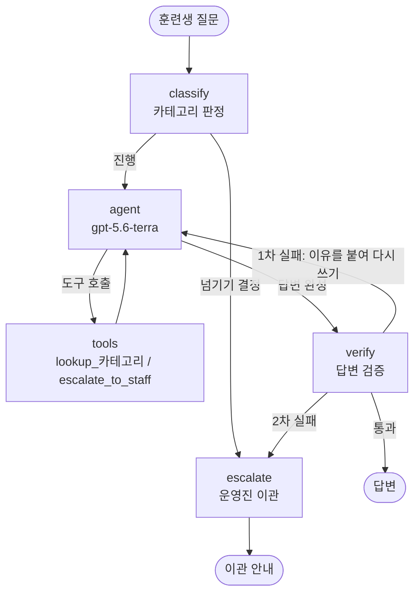
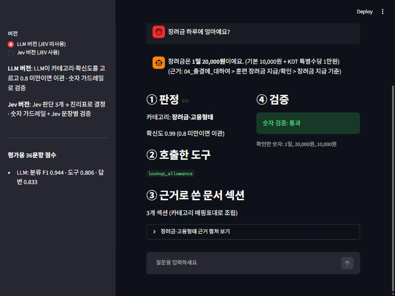
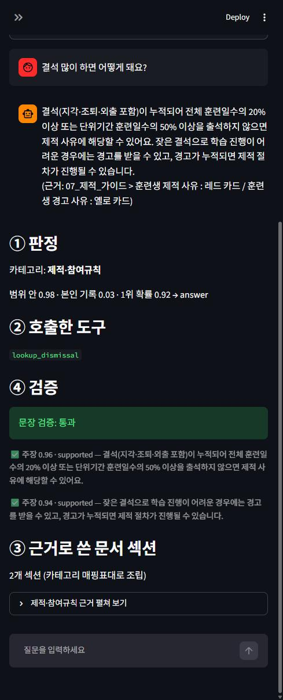

# REPORT — 모두연 AI 에이전트 2기 훈련생 상담 챗봇

- 작성자: Sung, Hyun-Joon
- 과제: 아이펠 AI 에이전트 2기 「에이전트 팀 꾸리기」 5번 노드 — 고객 응대 에이전트 만들기
- 저장소 구성과 실행법: [README.md](README.md)

---

## 1. 주제와 근거 문서

**무엇을:** 2기 훈련생이 출결·공가·장려금·제적 같은 규정을 물으면, 질문 종류를 가르고 → 그 종류의 공지만 근거로 → 답한 뒤 → 근거에 없는 내용이 섞였는지 검사하고, 문서로 답할 수 없으면 운영진에게 넘기는 챗봇.

**왜 이 주제인가:** 노드 5의 주제 조건 셋을 모두 만족한다.

| 조건 | 이 주제에서 |
|---|---|
| 카테고리 3~5개로 나뉨 | 출결·공가 / 장려금·고용형태 / 제적·참여규칙 / 학습생활 / 일정·수료 |
| 근거 문서가 충분히 김 | 2기 노션 공지 19개 문서, 약 4만 3천 자 |
| 문서에 없는데 그럴듯하게 답할 수 있는 질문 | "수료증은 어디서?", "중도 포기 위약금?", "제 장려금 얼마?" — 일반 상식으로 답하면 틀리거나 근거가 없다 |

그리고 작성자가 직접 겪는 규정이라 정답을 판단할 수 있다.

**근거 문서:** [docs/notion_2기/](docs/notion_2기/) — 2기 노션의 규정·운영 안내 19개를 md로 옮긴 것. 1기 공지는 일정·폼 링크가 달라 쓰지 않았고, 출석부·구성원 소개 같은 개인정보 페이지는 제외했다. 경계에 있던 문서 4개(과정 소개, 노드 수정 내역, 커리큘럼, 나의 도메인 개발하기)도 넣었다 — 과정 자체·노드 불만·일정 질문에 답하기 위해서이고, 커리큘럼은 "일정은 변동될 수 있어요", 도메인 개발은 "퍼실·매니저에게 연락"을 답변 규칙으로 붙였다.

**문서 정리에서 한 일**
- **문서끼리 어긋나는 9곳**을 찾아 [docs/CONFLICTS.md](docs/CONFLICTS.md)에 모았다(공가 폼 링크 3종, 신청 기한 "하루 전" vs "+1일", 점심 12:50 vs 13:00 등). 8곳은 작성자(2기 훈련생)가 직접 아는 내용으로 확정했고, 1곳(고용형태 신고 기한 1주 vs 2주)은 확인하지 못해 **운영진 이관**으로 처리한다.
- 원본 문서는 그대로 두고, 챗봇에게 건넬 때만 확정값으로 바꿔 끼운다(`common/context.py`의 `CORRECTIONS`). 다른 과정 안내문을 복사한 흔적(1기·프데분 닉네임 등)도 이 단계에서 숨긴다.
- **규정 숫자 29개**를 원문 표기 그대로 [docs/FIXED_VALUES.md](docs/FIXED_VALUES.md)에 정리했다(숫자 가드레일의 정답지). 37개 표기 모두 문서에서 문자열로 찾아지는 것을 확인했다.

## 2. 카테고리 설계

| id | 카테고리 | 다루는 질문 |
|---|---|---|
| `attendance` | 출결·공가 | 입·퇴실 시간, 지각·조퇴·외출·결석 기준, 공가·휴가 신청과 증빙, 캠 |
| `allowance` | 장려금·고용형태 | 훈련장려금 기준·금액, 고용형태 신고·변경, 아르바이트, 취업 시 |
| `dismissal` | 제적·참여규칙 | 제적 사유(레드카드), 경고(옐로카드), 참여 규칙 위반의 결과 |
| `learning` | 학습생활 | 질문 방법, ZEP·디스코드·LMS, 노드 저작권, 조별학습, 퀘스트, 도메인 개발 |
| `schedule` | 일정·수료 | 과정 소개, 훈련 기간·단위기간, 커리큘럼, 시간표, 수료·졸업 기준 |
| `out_of_scope` | 범위 밖 | 문서로 답할 수 없는 질문 — 잡담, 본인 기록 조회, 문서에 없는 규정 |

**나눈 기준 — 경계 규칙:** 질문 속 단어가 아니라 **답에 필요한 핵심 사실이 들어 있는 문서**로 보낸다. 헷갈리는 질문 6개로 경계를 먼저 시험해 이 규칙을 정했다.

| 경계 질문 | 카테고리 | 이유 |
|---|---|---|
| 결석 많이 하면 어떻게 돼요? | 제적 | 결과·불이익을 묻는다 |
| 병원 때문에 조퇴하면 장려금 깎여요? | 출결 | "장려금"이 들어 있지만 답은 공가 규정 "질병은 조퇴도 공결 인정"에 있다 |
| 수료하려면 출석률 몇 %? | 일정·수료 | 수료 기준은 훈련 정보 문서에 있다 |
| 알바 신고 안 하면 제적돼요? | 장려금 | 고용형태 안내 안에 "환수, 제적 등 불이익"이 적혀 있다 |
| 디스코드 닉네임 어떻게 해요? | 학습생활 | 외부 툴 사용법이지만 2기 닉네임 규칙이 문서에 있다 |
| 노드 질문은 어디에 해요? | 학습생활 | 수업 내용 질문은 일정·수료가 아니다 |

**매핑표:** [docs/MAPPING.md](docs/MAPPING.md) — 카테고리마다 문서 **섹션 단위**로 연결했다(30줄). 한 문서에 여러 주제가 섞인 경우(메인 공지, 출결, FAQ)는 섹션을 쪼개 나눴다. 이 표는 `common/context.py`의 `SECTION_MAP`으로 그대로 옮겨 근거 조립에 쓴다.
- 기본 시간표는 짧아서 출결·일정 두 곳에 **중복 연결**했다.
- 출결 문서의 "중요사항 한눈에 보기"는 수료·장려금·제적 숫자가 다 들어 있지만 **출결에만** 연결했다. 그 숫자들은 각자 원래 문서에 있고, "지각 3회 = 결석 1회"·"캠 미구동 시 결석 처리"·"HRD-Net 앱 확인"은 여기에만 있기 때문이다.

**카테고리별로 다른 근거만 들어가는지:** 조립 크기는 전체 문서 대비 출결 22% · 장려금 9% · 제적 11% · 학습생활 43% · 일정 17%. 문자열 검사 52개로 확인했다(장려금 근거에 제적 규정 없음, 틀린 링크·"+1일"·다른 기수 문장이 어디에도 없음, 확정값은 제자리에 있음 등 — `python -m common.context --check`). 확정값 반영을 끄고 장려금에 제적 문서를 섞으면 40/52로 떨어져, 검사가 실제로 잡는다는 것도 확인했다.

## 3. 평가셋 설계

[data/goldenset.json](data/goldenset.json) — **48문항** = 카테고리 6개 × (예시용 2 + 평가용 6).

| 항목 | 내용 |
|---|---|
| 기대 도구 | 카테고리별 조회 도구 5개(`lookup_attendance` 등) 또는 `escalate_to_staff`. 두 카테고리 문서가 다 필요한 문항 1개 |
| 반드시 담을 사실 | 사실 하나당 변형 여러 개 중 하나만 있으면 인정 (예: `20,000원` / `2만원` / `2만 원`) — 표현이 아니라 사실을 본다 |
| 말하면 안 되는 것 | 문서를 안 읽으면 나오기 쉬운 오답: 틀린 폼 링크, `+1일`, `13:00` 점심, 1기·프데분 닉네임, 일반 상식 금액 등 |
| 넘기기가 정답 | 6문항 — 본인 기록 조회 3, 문서에 없는 규정 2(수료증·위약금), 문서 충돌 미확정 1 |
| 분리 | 예시용(fewshot) 12개만 분류 프롬프트에 넣고, 평가용(eval) 36개는 측정에만 쓴다. 겹침 0 |

**만든 방법 (정직하게):** 시간 제약으로 **AI가 초안을 쓰고 작성자가 검토**했다. 편향을 줄이려고 챗봇 코드가 아직 없을 때, 구현과 분리된 별도 에이전트가 문서만 보고 작성하게 했다. 작성자는 채점 정책 4가지를 직접 정했다.
1. 미확정 값(1주/2주)은 두 값을 말해도 되고, 이관하면 정답
2. 잡담에는 "AI 에이전트 2기 관련 질문만 답변드릴 수 있어요"로 안내해야 정답
3. 경고성 위반은 **"제적될 수 있어요"** 로 순화 — 위반 즉시 무조건 제적이 아니므로 "즉시 제적", "제적됩니다"는 금지 표현
4. 답이 한 문서에 있으면 그 문서 하나만 조회해야 정답

**채점기 검증 (노드 5 요건: 모범 답안으로 먼저 검증):**
- 결과를 이미 아는 가짜 답안 4종(모범 / 금지 섞기 / 빈 답 / 답 없음)으로 자가 검사 → 4/4 통과
- **채점 기준을 모르는 에이전트**가 문서만 보고 쓴 자연스러운 모범 답안 36개 → 처음엔 34/36. 틀린 2개는 내용이 맞는데 **"안 돼요"라는 말끝** 때문에 부정 표현으로 인정되지 않은 것이었다. 채점 기준에 "안 돼/안돼"를 추가하고, 기대 도구가 넓었던 1문항을 고친 뒤 **36/36**. 이후 Step 8에서도 같은 종류(말끝 "사용할 수 없어요")를 1건 더 찾아 고쳤다.

## 4. 측정 결과

### 4-1. 카테고리 판정 (평가용 36문항, 판정 단계만)

| 방식 | 정확도 | macro F1 |
|---|---|---|
| 키워드 규칙 (기준선) | 0.472 | 0.451 |
| LLM (`gpt-5.6-luna`, 구조화 출력) | 0.889 | 0.888 |
| Jev (Choice 1 + Noul 2 → 진리표) | 0.917 | 0.913 |

- **규칙:** 키워드에 없는 단어(닉네임, 디코, LMS, 점심, 단위기간, 경고)를 쓴 질문은 전부 기본값인 "범위 밖"으로 떨어졌다. 학습생활은 6개 중 1개만 맞혔다.
- **LLM:** 틀린 4개 중 2개는 확신도 0.78로 가장 낮아 **넘기기 임계값 0.8**로 막았다. 나머지 2개는 0.95·0.97로 **자신 있게 틀렸다** — 확신도만으로는 막을 수 없다.
- **Jev:** LLM이 0.95로 틀린 문항(남의 얼굴 캡처 블로그 게시)을 "범위 안?" 확률 0.39로 애매하게 판단해 이관으로 막았다. 대신 분류는 맞혔는데 "범위 안?"이 0.60~0.64라 **괜히 넘긴 문항**이 3개 생겼다. 상담 챗봇에서는 틀린 답이 넘기기보다 비싸다고 보고, 진리표 출발값(0.7/0.3)을 그대로 확정했다.

### 4-2. 전체 파이프라인 (평가용 36문항, 최종)

| 버전 | 분류 정확도 | macro F1 | 도구 호출 적절성 | 답변 적절성 |
|---|---|---|---|---|
| LLM 버전 | 0.944 | 0.944 | 0.806 | 0.861 |
| Jev 버전 | 0.917 | 0.913 | 0.806 | 0.806 |

혼동 행렬 (행 = 정답, 열 = 예측)

```
LLM 버전          출결 장려금 제적 학습 일정 범위밖      Jev 버전          출결 장려금 제적 학습 일정 범위밖
출결                6    0    0    0    0    0         출결                6    0    0    0    0    0
장려금              0    6    0    0    0    0         장려금              0    6    0    0    0    0
제적                0    0    5    1    0    0         제적                0    0    5    1    0    0
학습생활            0    0    0    6    0    0         학습생활            0    0    0    6    0    0
일정·수료           0    0    0    0    6    0         일정·수료           0    0    0    0    6    0
범위 밖             0    0    0    0    1    5         범위 밖             0    0    1    0    1    4
```

### 4-3. 검증 단계 — "속여 보기" (일부러 틀린 답 8개)

검사기 코드를 보지 않은 별도 에이전트가 문서만 보고 그럴듯한 거짓 답 8개를 썼다.

| 유형 | 예 | 숫자 가드레일 | Jev 문장 검증 |
|---|---|---|---|
| 숫자 틀림 4 | 외출 복귀 **17:50**까지(정답 17:40) | **1** | **4** |
| 숫자 없는 지어내기 4 | 다음 달 휴가 당겨쓰기 **가능**(정답 불가) | **0** | **4** |

숫자 가드레일이 놓친 17:50·80%·50%는 모두 **문서 다른 곳에 다른 뜻으로 있는 숫자**다(17:50은 퇴실 시작, 80%는 수료 출석률, 50%는 단위기간 기준). "이 글자가 문서에 있나"만 보는 검사의 한계다. Jev는 8개 모두 "근거와 반대"로 막았다. 단, 숫자 가드레일은 계산한 숫자(예: "120일의 80% = 96일")나 근거를 조회하지 않고 말한 숫자처럼 **문서에 아예 없는 숫자**는 확실히 잡는다.

### 4-4. 틀린 문항 원인 (직접 읽고 분류)

최종 실행 기준 LLM 9문항, Jev 9문항.

| 원인 | LLM | Jev | 예 |
|---|---|---|---|
| 잘못 고른 근거 | 3 | 1 | Q023 제적 질문을 학습생활로 분류 / Q032 날짜를 물었는데 일정 문서를 조회하지 않음 / Q019 "지각 3회=결석 1회"가 있는 출결 문서를 조회하지 않음 |
| 빠진 사실 | 2 | 2 | Q029 "비밀유지서약서", Q036 "120일" 누락 |
| 조회한 뒤 이관 | 2 | 2 | Q045 수료증·Q046 위약금 — 문서를 먼저 보고 넘겼다(행동은 맞지만 평가셋은 "바로 이관"이 정답) |
| 도구 과다 호출 | 2 | 1 | Q003 답은 맞지만 장려금 문서까지 조회 / Q031 답한 뒤 이관까지 추가 |
| 진리표의 불필요한 이관 | — | 2 | Q004 영수증·Q016 국민취업지원 — 4-1에서 감수하기로 한 것 |
| 판정 단계 이관 (오분류를 막음) | — | 1 | Q023 — LLM은 틀린 카테고리로 답했고, Jev는 넘겼다 |

### 4-5. 개선 기록 (한 번에 하나씩, 매번 두 버전 재측정)

| # | 바꾼 것 | 노린 문항 | LLM 도구 / 답변 | Jev 도구 / 답변 | 결과 |
|---|---|---|---|---|---|
| 0 | 개선 전 | — | 0.806 / 0.833 | 0.750 / 0.750 | — |
| 1 | 답변 규칙: 본인 기록은 반드시 이관, "2기 관련만" 안내는 잡담에만 | Q043·Q044 | 0.778 / 0.833 | 0.750 / 0.750 | LLM 둘 다 고쳐짐 |
| 2 | 답변 규칙: 상황 질문엔 문서의 기준(숫자·조건)을 먼저 밝힘 | Q022 | 0.806 / 0.833 | 0.806 / 0.806 | 두 버전 모두 고쳐짐 |
| 3 | **채점 기준**: "사용할 수 없어요"도 부정으로 인정 | Q008 | 0.806 / 0.861 | 0.806 / 0.806 | 챗봇 개선이 아님 — 2번 결과를 다시 채점만 함 |

같은 설정이라도 실행마다 1~3문항이 오르내렸다(개선 1에서 LLM 도구 점수가 내려간 것은 노리지 않은 문항의 변동). 36문항에서 0.03~0.06 차이는 우연일 수 있어서, 전체 점수와 함께 **노린 문항이 실제로 고쳐졌는지**를 기록했다.

**그 밖의 수정:** Jev 버전 첫 전체 실행에서 2문항이 그래프 단계 수 제한(10)에 걸려 오류로 멈췄다. "검증 실패 → 다시 쓰기"가 들어가면 정상 경로도 10단계를 넘기 때문이라 20으로 올렸다.

## 5. 파이프라인 구조도

두 버전은 **같은 그래프**를 쓰고 판정(`classify`)과 검증(`verify`) 노드만 바꿔 끼운다. 그래서 점수 차이는 판정·검증 방식에서만 나온다.



| 노드 | LLM 버전 (`track_llm/`) | Jev 버전 (`track_jev/`) |
|---|---|---|
| classify | `gpt-5.6-luna` 구조화 출력(카테고리 `Literal` + 확신도) → 확신도 < 0.8이면 이관 | Jev 한 요청에 판단 3개(카테고리 Choice, "2기 과정 안내에 관한 질문인가" Noul, "본인 기록 조회인가" Noul) → 코드의 진리표로 결정 |
| agent ↔ tools | 공통. 첫 호출은 분류된 카테고리의 조회 도구를 **코드로 강제**(`tool_choice`) — 프롬프트는 요청일 뿐 보장이 아니다 | 같음 |
| verify | 숫자 가드레일 | 숫자 가드레일 → 통과하면 Jev 문장 검증(문장마다 뒷받침/반대/없음 Choice + "규정에 대한 주장인가" Noul → 진리표) |

**State:** `question` · `category` · `confidence` · `route_reason` · `messages`(agent·tools·verify 여러 곳에서 들어와 `add_messages` 리듀서로 이어 붙임) · `checks`(검증 기록) · `escalated`(이관 이유). 루프는 `recursion_limit` 20과 다시 쓰기 1회 제한으로 반드시 끝난다.

**Jev 진리표 (판정)**

| 범위 안? | 본인 기록? | 1위 카테고리 확률 | 결정 |
|---|---|---|---|
| < 0.3 | — | — | 범위 밖 안내 |
| 0.3 ~ 0.7 | — | — | 운영진 이관 |
| > 0.7 | > 0.7 | — | 운영진 이관 (본인 기록) |
| > 0.7 | 0.3 ~ 0.7 | — | 운영진 이관 |
| > 0.7 | < 0.3 | < 0.5 | 운영진 이관 |
| > 0.7 | < 0.3 | ≥ 0.5 | 그 카테고리로 답함 |

## 6. 데모 설계

`app.py` (streamlit). 노드 5 요건인 **답변 + 호출한 도구 + 근거로 쓴 문서 부분 + 검증 결과**를 한 화면에 보여 준다.

신경 쓴 부분
- **두 버전 전환:** 사이드바에서 LLM / Jev 버전을 바꿔 같은 질문을 비교할 수 있다. 평가용 36문항 점수도 사이드바에 표시한다.
- **번호로 흐름을 보여 줌:** ① 판정(카테고리와 확신도, Jev는 판단 재료 3개) → ② 호출한 도구 → ③ 근거 섹션(펼쳐서 원문 확인) → ④ 검증. 챗봇이 왜 그렇게 답했는지 따라갈 수 있게 했다.
- **Jev 검증은 문장 단위로:** 문장마다 "규정에 대한 주장인지"와 "근거가 뒷받침하는지"를 함께 보여 준다.
- **예시 질문 버튼 6개:** 정상 답변, 경계 질문, 본인 기록(이관), 잡담(범위 밖)을 한 번씩 눌러 볼 수 있다.
- 터미널용 `chat.py`도 같은 정보를 출력한다.

| LLM 버전 | Jev 버전 |
|---|---|
|  |  |

## 7. 프로젝트 회고

**공들인 부분**
- **문서 정리를 먼저 했다.** 문서끼리 어긋나는 9곳을 찾아 확정하지 않았다면 챗봇은 근거를 충실히 따르면서도 틀린 폼 링크를 안내했을 것이다. "근거만으로 답한다"는 근거가 맞을 때만 의미가 있다.
- **카테고리 경계를 단어가 아니라 "답이 있는 곳"으로 정했다.** 이 규칙 하나가 매핑표, 분류 지침, 평가셋의 기대 도구, 개선 판단까지 일관되게 이어졌다.
- **채점기를 먼저 의심했다.** 모범 답안 검증에서 한국어 말끝("안 돼요")을 틀리게 채점하는 문제를 두 번 찾았다. 채점기를 검증하지 않았다면 챗봇 탓으로 오해했을 것이다.

**두 버전 비교에서 배운 것**
- **점수표만 보면 LLM 버전이 조금 낫다**(답변 0.861 vs 0.806). 하지만 차이는 대부분 Jev 진리표가 **일부러 보수적으로** 넘긴 문항에서 나왔다.
- **Jev가 확실히 나은 곳은 "판단 재료를 따로 묻는" 자리였다.**
  - 본인 기록 질문을 처음부터 정확히 넘겼다(LLM은 답변 규칙을 고친 뒤에야 고쳐짐).
  - LLM이 자신 있게 틀린 분류를 "범위 안?" 확률로 막았다.
  - 무엇보다 **검증에서 차이가 컸다.** 거짓 답 8개 중 숫자 가드레일은 1개, Jev는 8개를 막았다. 평가셋 36문항은 정상 답변 위주라 이 차이가 점수에 잘 드러나지 않는데, 실제 운영에서 위험한 건 이런 그럴듯한 거짓말이다.
- "확신도를 관문으로 쓰지 말라"는 TypeSafe 가이드를 실제로 확인했다. LLM 확신도 0.95인 오답이 있었다.

**한계 (정직하게)**
- 평가셋·모범 답안·속여 보기 답은 AI가 초안을 썼다(작성자 검토, 구현과 분리된 에이전트 사용).
- LLM 넘기기 임계값 0.8은 평가용 문항의 확신도 표를 보고 정했다. 평가 점수가 실제보다 조금 좋게 나왔을 수 있다.
- 평가용 36문항은 작아서 실행마다 1~3문항이 흔들린다.

**향후 개선점**
1. 평가셋 정책 정리: "문서를 먼저 조회한 뒤 이관"을 정답으로 인정할지 정하기(지금은 Q045·Q046이 이 때문에 감점).
2. Jev 진리표의 "범위 안?" 중간대(0.3~0.7)에서 카테고리 확률이 높으면 답하게 하고, 대신 Jev 문장 검증으로 막는 구조를 별도 평가셋으로 시험하기.
3. 날짜·일수처럼 계산이 필요한 질문은 코드 도구(예: 단위기간 조회, 장려금 계산)로 처리하기.
4. 평가셋을 사람이 직접 더 써서 늘리고, 같은 설정을 여러 번 돌려 평균과 흔들림을 함께 보고하기.
